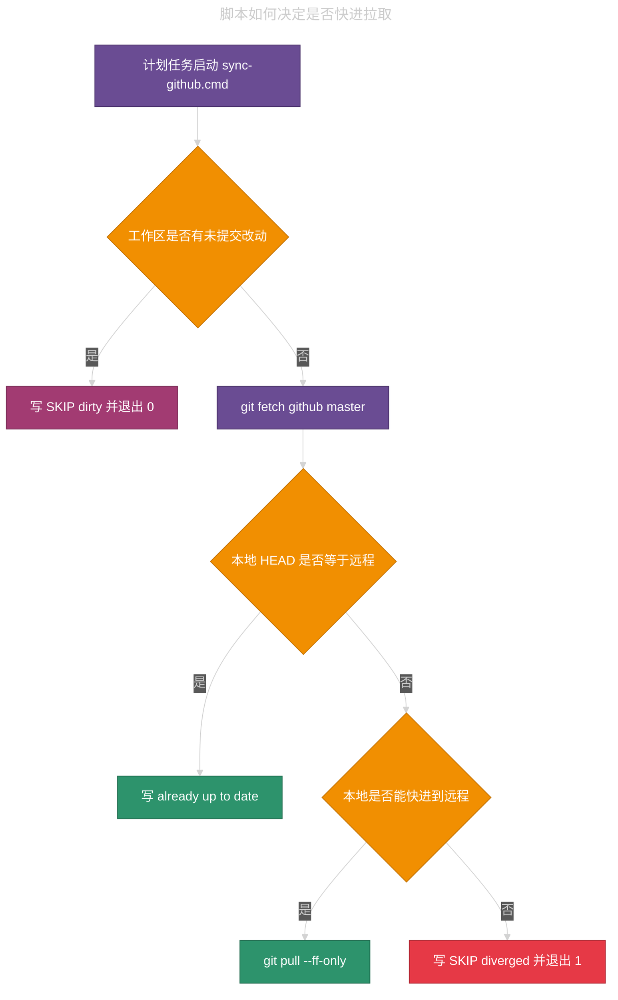

# `~/.cursor` 定时同步 GitHub

## 目录 • `~/.cursor` 定时同步 GitHub

- [1. 同步对象](#1-同步对象)
- [2. 计划任务](#2-计划任务)
- [3. 脚本与日志](#3-脚本与日志)
- [4. 一轮同步怎么决定](#4-一轮同步怎么决定)
- [5. 到点了仍可能不跑](#5-到点了仍可能不跑)
- [6. 常用维护](#6-常用维护)

---

本机用 Windows 计划任务，在每天 7:00 到 23:00 之间每小时快进拉取 `C:\Users\sn03910\.cursor`。远程是 `github` 上的 `master`。脚本不自动提交，也不自动推送。工作区有未提交改动时，这一轮会跳过拉取，本地文件保持原样。某一轮失败后，本小时内不再重试，等到下一个整点再跑。

## 1. 同步对象

同步的是 Cursor 用户目录 `C:\Users\sn03910\.cursor`，不是某个工程源码仓。该目录是 git 仓库，远程名是 `github`。

| <span style="color:#C9A0FF">项</span> | <span style="color:#C9A0FF">值</span> |
|------|------|
| 本地路径 | `C:\Users\sn03910\.cursor` |
| 远程名 | `github` |
| 远程 URL | `git@github.com:zxremail/cursor.config_mcp_rules_skills.git` |
| 跟踪分支 | `master`（`github/master`） |
| 同步方向 | 只拉取。不 `commit`，不 `push` |
| 合并策略 | `git pull --ff-only` |

## 2. 计划任务

任务名是 `CursorConfigGitSync`。打开方式：`Win + R`，输入 `taskschd.msc`，在「任务计划程序库」里找到该任务。改触发器时，右键任务 →「属性」→「触发器」→ 选中一行 →「编辑」。主窗口里的「触发器」页是只读预览，双击打不开编辑框。

| <span style="color:#C9A0FF">项</span> | <span style="color:#C9A0FF">值</span> |
|------|------|
| 任务名 | `CursorConfigGitSync` |
| 计划类型 | 每天 |
| 开始时间 | 07:00 |
| 重复间隔 | 1 小时 |
| 持续时间 | 16 小时（7:00 起算，最后一轮在 23:00） |
| 0:00–6:59 | 不运行 |
| 操作 | `wscript.exe //nologo` 跑 `sync-github.vbs`（隐藏窗口，避免弹出 `cmd.exe`） |
| 运行账户 | `RIGOLTECH\sn03910`，仅交互式登录 |
| 失败后立即重试 | 否。退出即结束，等到下一个整点 |
| 运行超时 | 超过 1 分钟则停止任务 |

「编辑触发器」里应对应：

- 「每天」，开始时间 `7:00:00`
- 勾选「重复任务间隔」，值为 `1 小时`
- 「持续时间」为 `16 小时`，不要选「无限期」
- 勾选「已启用」

## 3. 脚本与日志

计划任务走 `.vbs` 隐藏启动 Git Bash。`.sh` 才做 git 判断和拉取。不要把任务指回 `.cmd`，否则每次都会弹出黑色 `cmd.exe` 窗口。

| <span style="color:#C9A0FF">文件</span> | <span style="color:#C9A0FF">作用</span> |
|------|------|
| `C:\Users\sn03910\.cursor\tools\sync-github.vbs` | 计划任务入口。用窗口样式 0 调用 Git Bash，不显示控制台。 |
| `C:\Users\sn03910\.cursor\tools\sync-github.cmd` | 仅供手动双击。会弹出控制台，不要给计划任务用。 |
| `C:\Users\sn03910\.cursor\tools\sync-github.sh` | 检查工作区，再 `git fetch` / `git pull --ff-only`。 |
| `C:\Users\sn03910\.cursor\ai-tracking\github-sync.log` | 每次运行追加一行时间戳和结果。 |

手动立刻拉一次：双击 `sync-github.cmd`，或在 Git Bash 里执行：

```bash
~/.cursor/tools/sync-github.sh
```

看最近结果：

```bash
tail -n 40 ~/.cursor/ai-tracking/github-sync.log
```

日志关键字：

| <span style="color:#C9A0FF">关键字</span> | <span style="color:#C9A0FF">含义</span> |
|------|------|
| `OK: already up to date` | 本地 `HEAD` 已与 `github/master` 相同。 |
| `OK: fast-forwarded` | 快进拉取成功。 |
| `SKIP: working tree dirty` | 有未提交或未跟踪改动，本轮未拉取。退出码 0。 |
| `SKIP: local master has diverged` | 本地提交与远程分叉，不能快进。退出码 1。 |
| `FAIL: git fetch failed` | 本轮 `fetch` 失败（常见于没网或 SSH）。不重试，退出码 1。 |
| `FAIL: git pull --ff-only failed` | 本轮快进拉取失败。不重试，退出码 1。 |

`tools/` 落在 Cursor 托管的 gitignore 规则里，这两个脚本默认不会进 GitHub 仓。

## 4. 一轮同步怎么决定

计划任务只负责到点启动。是否真的 `pull`，由 `sync-github.sh` 决定。



| <span style="color:#C9A0FF">本地状态</span> | <span style="color:#C9A0FF">会不会 pull</span> | <span style="color:#C9A0FF">计划任务结果</span> | <span style="color:#C9A0FF">说明</span> |
|------|------|------|------|
| 工作区干净，且能快进 | 会 | 成功 | 脚本把 `master` 快进到 `github/master`。 |
| 工作区干净，已与远程相同 | 否 | 成功 | 无需拉取。日志写 already up to date。 |
| 有未提交或未跟踪改动 | 否 | 成功 | 为避免覆盖正在改的 skills / rules，脚本跳过拉取。 |
| 已提交，但与远程分叉 | 否 | 失败 | 不能 `--ff-only`。需要人工 rebase 或合并后再同步。 |

有未提交修改时，同步**不会覆盖本地文件**。远程新提交也进不来，要等你提交、还原或清干净工作区之后的下一轮。

## 5. 到点了仍可能不跑

「条件」页和登录方式会挡住部分触发。当前默认如下。

| <span style="color:#C9A0FF">条件</span> | <span style="color:#C9A0FF">当前</span> | <span style="color:#C9A0FF">影响</span> |
|------|------|------|
| 仅空闲时启动 | 否 | 不要求电脑闲着。 |
| 仅交流电源 | 是 | 笔记本走电池时不启动。正在跑时改电池会停。 |
| 唤醒计算机 | 否 | 睡眠或休眠时不会为同步叫醒机器。 |
| 要求特定网络 | 否 | 没网仍会启动，然后 `git fetch` 失败并写入日志。 |
| 仅交互式登录 | 是 | 未登录 Windows 会话时通常不跑。 |
| 过了计划时间立即补跑 | 否 | 关机错过整点后，开机不会立刻补拉，等到下一个整点。 |
| 失败后按频率重新启动 | 否 | 「设置」里不要勾选该项。`git fetch` / `git pull` 失败只记日志并退出，下一小时再试。 |
| 运行超过以下时间则停止 | 1 分钟 | SSH 或 git 卡住超过 1 分钟会被杀掉。本小时内不重试，等到下一个整点。 |

「设置」页里「请勿启动新实例」表示上一轮还在跑时，到点了不再开第二个，避免两路 `git pull` 同时改同一仓库。失败立即重试保持关闭：不要勾选「如果任务失败，按以下频率重新启动」。

## 6. 常用维护

立即运行：任务计划程序里选中 `CursorConfigGitSync`，右侧点「运行」。不应再出现黑色 `cmd.exe` 窗口。结果仍写在 `C:\Users\sn03910\.cursor\ai-tracking\github-sync.log`。

改间隔：属性 → 触发器 → 编辑。改完点确定。

停用但不删除：属性 → 常规 → 取消「已启用」；或触发器里取消「已启用」。

删除任务：

```bat
schtasks /Delete /TN CursorConfigGitSync /F
```

重建当前规则（每天 7:00 起，每小时一次，持续 16 小时；`schtasks /Create` 默认不会打开失败重试）：

```bat
schtasks /Create /F /TN CursorConfigGitSync /SC DAILY /ST 07:00 /RI 60 /DU 16:00 /TR "C:\Windows\System32\wscript.exe //nologo C:\Users\sn03910\.cursor\tools\sync-github.vbs" /RL LIMITED
```

重建后请打开「设置」，确认：

- 「如果任务失败，按以下频率重新启动」未勾选
- 「如果任务运行时间超过以下时间，停止任务」为 **1 分钟**（`schtasks /Create` 默认往往是 72 小时，需要改回来）

Git Bash 里调用 `schtasks` 时，要把 `/Create` 这类开关写成 `//Create`，或先设 `MSYS_NO_PATHCONV=1`。否则 Git Bash 会把 `/Create` 当成路径。
