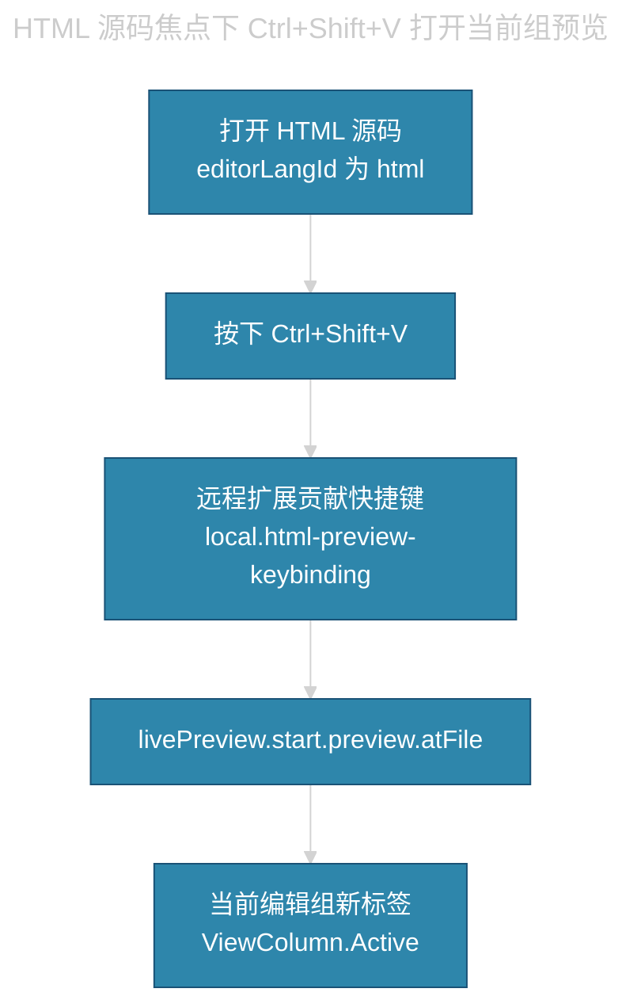

# Cursor HTML 整页预览


## 目录 • Cursor HTML 整页预览

- [1. 怎么用](#1-怎么用)
- [2. 为什么这样改](#2-为什么这样改)
- [3. 改动总表](#3-改动总表)
- [4. Live Preview 本体](#4-live-preview-本体)
  - [4.1 快捷键声明](#41-快捷键声明)
  - [4.2 取消分屏](#42-取消分屏)
- [5. 本地快捷键扩展](#5-本地快捷键扩展)
- [6. 远程用户快捷键（备份）](#6-远程用户快捷键备份)
- [7. 按键路径](#7-按键路径)
- [8. 升级后怎么补](#8-升级后怎么补)
- [9. 明确未改](#9-明确未改)

---

本机用 SSH 连 Ubuntu 虚拟机。Cursor 没有可用的「Open in Browser」。要在编辑器里用 `Ctrl+Shift+V` 整页预览 HTML，需要装「Live Preview」，并补快捷键、改打开位置。工作区源码仓未改。

## 1. 怎么用

1. 打开 `.html` 源码，焦点留在编辑器，不要放在聊天或预览窗。
2. 按 `Ctrl+Shift+V`。命令与右键「Show Preview」相同。
3. 预览出现在**当前编辑组**的新标签，不左右分屏。源码仍在同组其它标签。
4. 改 HTML 会自动刷新。

首次安装或改过扩展清单后，先 `Ctrl+Shift+P` → `Reload Window`。

Markdown 的 `Ctrl+Shift+V` 不受影响。该键只在 `editorLangId == html` 时走 Live Preview。

## 2. 为什么这样改

| <span style="color:#C9A0FF">问题</span> | <span style="color:#C9A0FF">原因</span> | <span style="color:#C9A0FF">做法</span> |
|------|------|------|
| 找不到 Open in Browser | 标签页菜单经常没有该项；本机是 SSH 远程会话 | 装 Live Preview，用 Show Preview |
| 远程 `keybindings.json` 按了没反应 | SSH 用户快捷键在**本机 Cursor**；虚拟机里那份不生效 | 由远程扩展 `contributes.keybindings` 声明按键 |
| 预览左右切开 | Live Preview 源码写死 `ViewColumn.Beside` | 改成 `ViewColumn.Active` |

`file://` 常被内置浏览器拒绝。Live Preview 自己起本地 HTTP，不需要再手开 `python3 -m http.server`。

## 3. 改动总表

会话发生在 SSH 主机 `local_vmware_ubuntu_2204`。根目录是 `~/.cursor-server/`。`a.rea` 工程文件未动。`settings.json` 未动。

| <span style="color:#C9A0FF">类别</span> | <span style="color:#C9A0FF">路径</span> | <span style="color:#C9A0FF">做什么</span> |
|------|------|------|
| 新装市场扩展 | `ms-vscode.live-server` v0.4.20 | 提供内嵌预览、右键 Show Preview、热刷新 |
| 改扩展清单 | `package.json` | 为 HTML 声明 `Ctrl+Shift+V` |
| 改扩展逻辑 | `out/extension.js` | 预览打开位置从右侧分栏改为当前组 |
| 新建本地扩展 | `local.html-preview-keybinding-0.0.1/` | SSH 下把快捷键接到同一条 Show Preview 命令 |
| 登记扩展 | `extensions.json` | 登记 `local.html-preview-keybinding` |
| 远程用户快捷键 | `data/User/keybindings.json` | 内容与上相同；SSH 下通常不生效，可当备份 |

## 4. Live Preview 本体

安装位置：

`~/.cursor-server/extensions/ms-vscode.live-server-0.4.20-universal/`

### 4.1 快捷键声明

文件：`package.json` 的 `contributes.keybindings`。

| <span style="color:#C9A0FF">项</span> | <span style="color:#C9A0FF">值</span> |
|------|------|
| 命令 | `livePreview.start.preview.atFile`（与右键 Show Preview 相同） |
| 键 | `ctrl+shift+v`（macOS 为 `cmd+shift+v`） |
| when | `editorLangId == html && !notebookEditorFocused && editorTextFocus` |

更新「Live Preview」后，这段声明会丢，需要再补。

### 4.2 取消分屏

文件：`out/extension.js`。

两处 `c.ViewColumn.Beside` 改为 `c.ViewColumn.Active`：

- 已有预览面板时的 `reveal`
- 新建 `createWebviewPanel`

效果：预览作为当前编辑组的标签打开，不再在右侧开一列。源码标签还在，不是 Markdown 那种原地替换。

更新扩展后，这两处也会回到 `Beside`，需要再改。

## 5. 本地快捷键扩展

目录：`~/.cursor-server/extensions/local.html-preview-keybinding-0.0.1/`

| <span style="color:#C9A0FF">文件</span> | <span style="color:#C9A0FF">作用</span> |
|------|------|
| `package.json` | 依赖 `ms-vscode.live-server`；在 HTML 语言激活；贡献与 §4.1 相同的按键 |
| `extension.js` | 空 `activate` / `deactivate`，只靠贡献点 |

`~/.cursor-server/extensions/extensions.json` 增加标识 `local.html-preview-keybinding`，`source` 为 `vsix`，`pinned` 为 true。

这条是 SSH 下快捷键真正生效的路径。只改虚拟机里的 `keybindings.json` 不够。

## 6. 远程用户快捷键（备份）

文件：`~/.cursor-server/data/User/keybindings.json`

```json
[
    {
        "key": "ctrl+shift+v",
        "command": "livePreview.start.preview.atFile",
        "when": "editorLangId == html && !notebookEditorFocused && editorTextFocus"
    }
]
```

本机 Cursor（连 SSH 的那一侧）的用户快捷键若要自己写，打开 `Ctrl+K` 再 `Ctrl+S`，绑同一命令。不要只改远程这份。

## 7. 按键路径



右键「Show Preview」从 `cmd` 起同一条路，不经过快捷键扩展。

## 8. 升级后怎么补

| <span style="color:#C9A0FF">动作</span> | <span style="color:#C9A0FF">会丢</span> | <span style="color:#C9A0FF">不会丢</span> |
|------|------|------|
| 更新 Live Preview | `package.json` 按键、`extension.js` 的 Active | 本地扩展、`extensions.json` 登记 |
| 只重载窗口 | 无 | 已改文件仍在磁盘上 |
| 换一台未装扩展的远程 | 全部要重做 | 本文可当清单 |

补分屏：在新版本 `out/extension.js` 里再把两处 `ViewColumn.Beside` 换成 `ViewColumn.Active`，然后重载窗口。

## 9. 明确未改

- `/home/adil/y.apps/a.rea` 及其中的 `architecture.html`
- `~/.cursor-server/data/User/settings.json`
- Markdown Preview Enhanced
- 本机 Windows 侧 `%APPDATA%\Cursor\User\keybindings.json`（未直接写入）
