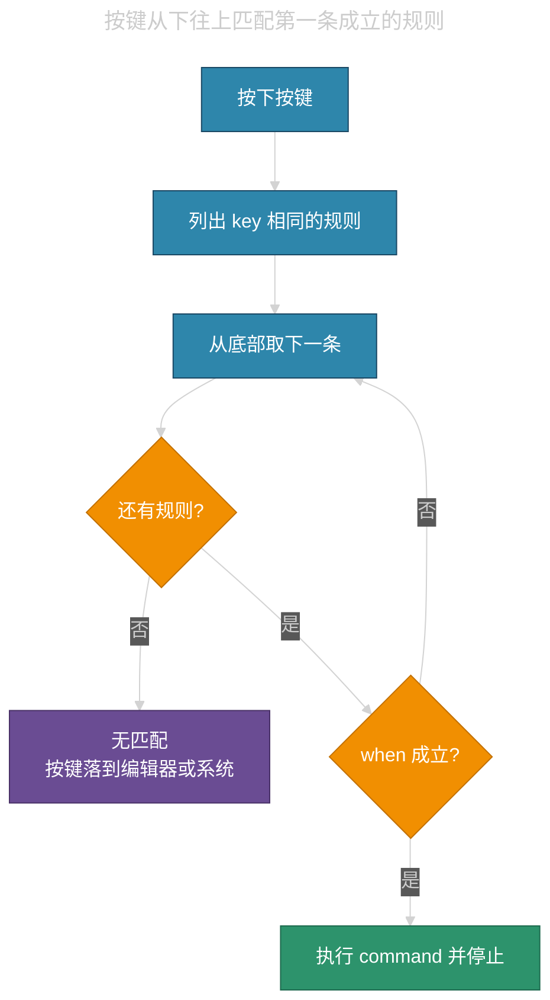
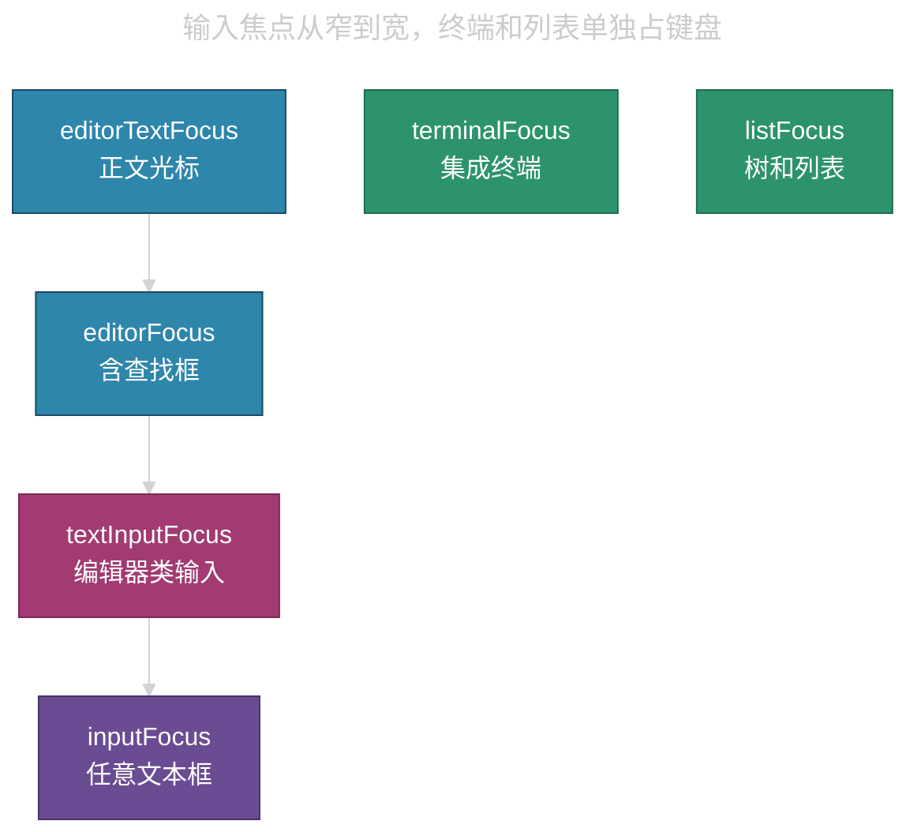

# Cursor `keybindings.json` 与焦点上下文


## 目录 • Cursor `keybindings.json` 与焦点上下文

- [1. 文件在哪](#1-文件在哪)
- [2. 一条规则长什么样](#2-一条规则长什么样)
- [3. 匹配顺序](#3-匹配顺序)
- [4. 按键写法](#4-按键写法)
- [5. 取消与改键](#5-取消与改键)
- [6. 命令参数与连跑](#6-命令参数与连跑)
- [7. when 表达式](#7-when-表达式)
- [8. 焦点上下文键](#8-焦点上下文键)
  - [8.1 输入层](#81-输入层)
  - [8.2 布局区](#82-布局区)
  - [8.3 资源管理器与列表](#83-资源管理器与列表)
  - [8.4 终端与 Notebook](#84-终端与-notebook)
  - [8.5 Cursor 面板](#85-cursor-面板)
- [9. 怎么查](#9-怎么查)
- [10. 常用配方](#10-常用配方)
- [11. 常见失败](#11-常见失败)
- [12. 参考](#12-参考)

---

Cursor 的快捷键与 VS Code 同一套规则。用户文件是 JSONC（允许 `//` 注释）。一条规则由 `key`、`command`、可选的 `when`、可选的 `args` 组成。没有 `when` 时，该键在任何焦点下都参与匹配。官方上下文表不穷尽；本机以默认快捷键 JSON 和「Inspect Context Keys」为准。

## 1. 文件在哪

| <span style="color:#C9A0FF">位置</span> | <span style="color:#C9A0FF">路径或命令</span> | <span style="color:#C9A0FF">做什么</span> |
|------|------|------|
| 本机用户规则 | Windows：`%APPDATA%\Cursor\User\keybindings.json`<br>Linux 本机：`~/.config/Cursor/User/keybindings.json` | 客户端真正执行的用户快捷键 |
| SSH 远程里那份 | `~/.cursor-server/data/User/keybindings.json` | 多数情况下**不**驱动本机按键。远程会话的用户快捷键在**本机 Cursor**。详见 [cursor-html-live-preview.md](cursor-html-live-preview.md) |
| 默认规则 | 命令面板：`Preferences: Open Default Keyboard Shortcuts (JSON)` | 只读。改键时对照 `command` 和 `when` 再写解除规则 |
| 图形界面 | `Preferences: Open Keyboard Shortcuts`（Linux 默认和弦是 `Ctrl+K Ctrl+S`） | 搜命令、搜按键、看冲突。改完会写回用户 JSON |

打开 JSON 的命令是 `Preferences: Open Keyboard Shortcuts (JSON)`。文件被监视：保存后立即生效，不必重载窗口。语法错误时整份用户规则可能失效，表现为改了键却仍走默认。

远程要让某键稳定生效，优先让扩展用 `contributes.keybindings` 声明，而不是只改远程用户 JSON。

## 2. 一条规则长什么样

```jsonc
{
    "key": "ctrl+shift+v",
    "command": "livePreview.start.preview.atFile",
    "when": "editorLangId == html && !notebookEditorFocused && editorTextFocus"
}
```

| <span style="color:#C9A0FF">字段</span> | <span style="color:#C9A0FF">是否必填</span> | <span style="color:#C9A0FF">含义</span> |
|------|------|------|
| `key` | 必填 | 修饰键加主键。和弦用空格分开两段 |
| `command` | 必填 | 命令 ID。前缀 `-` 表示解除。空字符串表示吞掉该键 |
| `when` | 可选 | 布尔表达式。省略则全局参与匹配 |
| `args` | 可选 | 传给命令的参数对象或数组 |
| `systemWide` | 可选 | 为 `true` 时，Cursor 在前台运行期间，操作系统其它窗口也能触发。只支持单组合，不支持和弦；触发时忽略 `when`。桌面版用户规则才有效 |

图形界面里改键，会把默认规则的 `when` 一并抄进用户文件。手写时建议同样抄全，否则解除对不上，默认仍在。

## 3. 匹配顺序

运行时把用户规则**接到默认规则末尾**。按键按下后：

1. 收集 `key` 相同的规则。
2. **从下往上**扫描。
3. 第一条同时满足 `key` 和 `when` 的规则被接受。
4. 接受后不再往上扫。有 `command` 就执行。

因此用户文件里**靠后**的条目优先于靠前的；用户文件整体优先于默认。同一键、不同 `when` 可以共存，例如调试中 `F5` 继续、未调试时 `F5` 启动。



## 4. 按键写法

修饰键：

| <span style="color:#C9A0FF">平台</span> | <span style="color:#C9A0FF">可写</span> |
|------|------|
| Windows | `ctrl+`、`shift+`、`alt+`、`win+` |
| Linux | `ctrl+`、`shift+`、`alt+`、`meta+` |
| macOS | `ctrl+`、`shift+`、`alt+`、`cmd+` |

主键示例：`a`–`z`、`0`–`9`、`f1`–`f19`、`left` / `up` / `right` / `down`、`tab`、`enter`、`escape`、`space`、`backspace`、`delete`、`home`、`end`、`pageup`、`pagedown`、小键盘 `numpad0` 等。

和弦：两段之间一个空格，例如 `ctrl+k ctrl+s`。第一段按下后进入等待，超时或第二段不匹配则取消。

Cursor 里 `Ctrl+K`（macOS 为 `Cmd+K`）常被内联编辑占用。Linux / Windows 上部分默认和弦改成 `Ctrl+M` 作引导键。给 Cursor 写和弦前，先在默认 JSON 里搜该引导键，避免和内联编辑抢。

`keybindings.json` 里的键名按 **US 布局虚拟键** 写。当前系统布局不是 US 时，编辑器会标出「文件里写的字符」和「你键盘上的键帽」不一致。可用 `Ctrl+K Ctrl+K`（Define Keybinding）让编辑器听一次按键再插入 JSON。Linux 改布局后建议重启 Cursor，布局在启动时缓存。

与布局无关的写法用扫描码，例如 `"key": "ctrl+[Slash]"`。

Windows 上 `;` 一类 OEM 键有时写成 `oem_1`。用户文件里出现 `ctrl+oem_1` 时，对应 US 布局的分号键。

## 5. 取消与改键

解除默认：`command` 前加 `-`。`key` 要与默认相同。`when` 能抄则抄，抄不全时解除可能对不上那一条。

```jsonc
{
    "key": "ctrl+shift+v",
    "command": "-markdown.showPreview",
    "when": "!notebookEditorFocused && editorLangId == 'markdown'"
}
```

同一键改给别的命令：先写解除，再写新绑定。用户文件靠后优先，只写新绑定、不解除，旧规则仍可能在 `when` 更宽时被别的条目抢走。从下往上扫时，新绑定若写在解除下面且 `when` 成立，会先命中新绑定。

吞掉某键、什么也不做：

```jsonc
{ "key": "tab", "command": "" }
```

图形界面「Remove Keybinding」会生成 `-command` 条目。

## 6. 命令参数与连跑

带 `args` 的例子：把 `Enter` 改成插入固定文本。

```jsonc
{
    "key": "enter",
    "command": "type",
    "args": { "text": "Hello World" },
    "when": "editorTextFocus"
}
```

连跑用 `runCommands`：

```jsonc
{
    "key": "ctrl+alt+c",
    "command": "runCommands",
    "args": {
        "commands": [
            "editor.action.copyLinesDownAction",
            "cursorUp",
            "editor.action.addCommentLine",
            "cursorDown"
        ]
    }
}
```

子命令也可以各自带 `args`。传多个位置参数时，`args` 写成数组。数组本身要当第一个参数时，再包一层：`"args": [ [1, 2, 3] ]`。

指定格式化器而不改默认设置：

```jsonc
{
    "key": "ctrl+alt+f",
    "command": "editor.action.formatDocument.multiple",
    "args": { "formatter": "esbenp.prettier-vscode" },
    "when": "editorTextFocus && !editorReadonly"
}
```

重构类：`editor.action.codeAction` 加 `"args": { "kind": "refactor.extract.function" }`。

命令 ID 从命令面板右侧齿轮、或键盘快捷方式编辑器的「Command ID」列复制。扩展贡献的命令会带发布者前缀。

## 7. when 表达式

无 `when` = 全局。运算符优先级：`!` 高于 `&&`，`&&` 高于 `||`。

| <span style="color:#C9A0FF">运算符</span> | <span style="color:#C9A0FF">写法</span> | <span style="color:#C9A0FF">例子</span> |
|------|------|------|
| 与 | `&&` | `editorTextFocus && !editorReadonly` |
| 或 | `\|\|` | `terminalFocus \|\| panelFocus` |
| 非 | `!` | `!terminalFocus` |
| 相等 | `==` | `editorLangId == html` |
| 不等 | `!=` | `resourceExtname != .js` |
| 正则 | `=~` | `focusedView =~ /^workbench.panel.aichat.view/` |
| 成员 | `in` / `not in` | 列表型上下文 |

`||` 绑得最松。下面这句会在终端里也成立：

```text
editorTextFocus && editorLangId == typescript || terminalFocus
```

应写成两条规则，或加括号：

```text
editorTextFocus && editorLangId == 'typescript'
```

默认规则里常见超长 `||`。手改时先看括号，再决定要不要整段抄过来。

语言和资源：

- `editorLangId == html`：活动编辑器语言
- `resourceFilename`、`resourceExtname`、`resourcePath`、`resourceScheme`
- `isLinux` / `isWindows` / `isMac`

可见性不等于焦点：`sideBarVisible` 只表示边栏开着；真正占键盘的是 `sideBarFocus`。

## 8. 焦点上下文键

列表不穷尽。布尔键为真表示「这类 UI 正在收键盘」。`focusedView` 是字符串，比较的是视图 ID。

### 8.1 输入层

从窄到宽：

| <span style="color:#C9A0FF">键</span> | <span style="color:#C9A0FF">为真时</span> |
|------|------|
| `editorTextFocus` | 编辑器**正文**有焦点，光标在闪。查找框、简单输入框不算 |
| `editorFocus` | 编辑器或编辑器控件有焦点，例如查找框 |
| `textInputFocus` | 任意「编辑器类」输入：正文、Debug REPL、部分富文本框 |
| `inputFocus` | 任意文本输入，含搜索框、许多聊天输入 |

`editorTextFocus` 成立时，上面三层通常也成立。聊天输入经常是 `inputFocus` / `textInputFocus`，**不是** `editorTextFocus`。编辑命令应写 `editorTextFocus`。不要让全局命令进输入框时，用 `!textInputFocus` 或 `!inputFocus`。



终端、列表会占用键盘，但不是 `editorTextFocus` 的子集。终端里 `terminalFocus` 为真，正文焦点为假。

其它输入相关：

| <span style="color:#C9A0FF">键</span> | <span style="color:#C9A0FF">为真时</span> |
|------|------|
| `editorTabMovesFocus` | `Tab` 会把焦点移出编辑器，而不是插入缩进 |
| `editorSimpleInput` | 简单编辑器控件，不是完整代码编辑器 |
| `inQuickOpen` | 命令面板 / Quick Open 有焦点 |
| `inDebugRepl` | 焦点在调试控制台 REPL |

### 8.2 布局区

| <span style="color:#C9A0FF">键</span> | <span style="color:#C9A0FF">为真时</span> |
|------|------|
| `sideBarFocus` | 左侧活动栏对应的边栏有焦点 |
| `panelFocus` | 底部面板有焦点 |
| `auxiliaryBarFocus` | 右侧辅助栏有焦点。Chat / Composer 常在这里 |
| `notificationFocus` | 通知有键盘焦点 |
| `isAuxiliaryWindowFocusedContext` | 辅助窗口有焦点 |
| `focusedView` | 当前焦点视图的 ID，用 `==` 或 `=~` 比较 |

指定某个视图：`sideBarFocus && activeViewlet == 'workbench.view.explorer'`。右侧类似：`auxiliaryBarFocus` 加 `activeAuxiliary`。

### 8.3 资源管理器与列表

| <span style="color:#C9A0FF">键</span> | <span style="color:#C9A0FF">为真时</span> |
|------|------|
| `listFocus` | 任意列表或树 |
| `listHasSelectionOrFocus` | 列表有选中或焦点 |
| `explorerViewletFocus` | 资源管理器视图 |
| `filesExplorerFocus` | 文件树那一段 |
| `openEditorsFocus` | 「打开的编辑器」那一段 |

文件树快捷键常用 `filesExplorerFocus && !inputFocus`，避免在内联重命名输入框里误触发。

### 8.4 终端与 Notebook

| <span style="color:#C9A0FF">键</span> | <span style="color:#C9A0FF">为真时</span> |
|------|------|
| `terminalFocus` | 集成终端有焦点 |
| `terminalEditorFocus` | 终端作为编辑器标签打开且有焦点 |
| `terminalIsOpen` | 已经有终端实例，不表示焦点 |
| `notebookEditorFocused` | Notebook 编辑器有焦点 |
| `notebookCellListFocused` | 焦点在 cell 列表 |
| `notebookOutputFocused` | 焦点在 cell 输出 |

同一键在终端复制、在编辑器走插件，用两条规则：

```jsonc
{ "key": "ctrl+shift+alt+c", "command": "uncPath.copyFile", "when": "!terminalFocus" },
{ "key": "ctrl+shift+alt+c", "command": "workbench.action.terminal.copySelection", "when": "terminalFocus" }
```

Markdown 预览不要进 Notebook：`!notebookEditorFocused && editorLangId == 'markdown'`。

### 8.5 Cursor 面板

Cursor 没有稳定公开的全表。社区默认快捷键和论坛里常见：

| <span style="color:#C9A0FF">键或写法</span> | <span style="color:#C9A0FF">用途</span> |
|------|------|
| `composerFocused` | Composer / Agent 面板有焦点 |
| `focusedView =~ /^workbench.panel.aichat.view/` | 聊天视图 ID 前缀匹配 |
| `focusedView == 'workbench.panel.composerViewPane2.view'` | 较旧的 Composer 视图 ID |

名字会随版本改。改 Chat 相关键之前，用 Inspect Context Keys 点一次输入框，以本机构建为准。

Agent 与编辑器切换：默认常用 `Ctrl+1`（`workbench.action.focusFirstEditorGroup`）。Cursor 可能另有 `cursor.chatEditorGroup.enabled` 一类键，解除默认时要把那条 `when` 一并抄上。

历史问题：部分版本里 Chat / 内联编辑不尊重用户 `when`，或 `sideBarFocus` 行为与 VS Code 不一致。绑定失败时先开键盘排障日志，再查是否被 Chat 输入吃掉。

## 9. 怎么查

| <span style="color:#C9A0FF">手段</span> | <span style="color:#C9A0FF">用途</span> |
|------|------|
| 键盘快捷方式编辑器搜按键 | 看同一键绑了哪些命令、`when` 是什么 |
| 右键「Show Same Keybindings」 | 冲突列表 |
| `@source:user` | 只看用户改过的 |
| `Preferences: Open Default Keyboard Shortcuts (JSON)` 搜 `Focus` | 本机构建实际用到的焦点键 |
| `Developer: Inspect Context Keys` | 点 UI，输出当前全部上下文及取值 |
| `Developer: Toggle Keyboard Shortcuts Troubleshooting` | Output 里打出检测到的键、命中的规则、`when`、来源（built-in / user / 扩展） |

排障日志示例含义：`From 2 keybinding entries, matched editor.action.commentLine, when: editorTextFocus && !editorReadonly, source: built-in`。说明有两条候选，真正执行的是内置那条。

## 10. 常用配方

只在 HTML 正文预览，不动 Markdown 的 `Ctrl+Shift+V`：

```jsonc
{
    "key": "ctrl+shift+v",
    "command": "livePreview.start.preview.atFile",
    "when": "editorLangId == html && !notebookEditorFocused && editorTextFocus"
}
```

只对某一语言启用块注释：

```jsonc
{
    "key": "shift+alt+a",
    "command": "editor.action.blockComment",
    "when": "editorTextFocus && editorLangId == csharp"
}
```

从 Composer 解除「新建」以免和系统新建抢键（版本相关，先对照默认 JSON）：

```jsonc
{
    "key": "ctrl+n",
    "command": "-composer.createNew",
    "when": "composerFocused || focusedView =~ /^workbench.panel.aichat.view/"
}
```

图形界面里有人用 `neverMatch =~ /doesNotMatch/` 让某条默认「理论上永不成立」，从而腾出按键。能直接 `-command` 时，解除更清楚。

## 11. 常见失败

| <span style="color:#C9A0FF">现象</span> | <span style="color:#C9A0FF">原因</span> | <span style="color:#C9A0FF">做法</span> |
|------|------|------|
| 改了 JSON 完全不生效 | JSONC 语法错误：缺逗号、多余逗号位置不对、未闭合括号 | 看编辑器红线和「问题」面板。对象之间必须有逗号 |
| 编辑器里好用，聊天框也触发 | `when` 太宽或省略 | 编辑命令加 `editorTextFocus`；全局命令加 `!textInputFocus` |
| 编辑器里好用，文件树或终端没有 | `when` 过窄 | 按区域拆成多条，或改用 `listFocus` / `terminalFocus` |
| 解除了仍走默认 | `-command` 的 `key` / `when` 与默认不一致 | 从默认 JSON 整行复制再加 `-` |
| SSH 远程改用户 JSON 没反应 | 按键由本机客户端派发 | 改本机用户文件，或让扩展贡献按键 |
| Chat 里 `when` 被忽略 | Cursor 部分输入面把按键当聊天文本 | 查当前版本论坛；用排障日志确认有没有进入 keybinding 匹配 |
| `||` 意外扩大范围 | 优先级低于 `&&` | 拆成两条，或加括号 |
| 布局不是 US，键对不上 | JSON 写的是虚拟键 | 用 Define Keybinding 插入，或改扫描码 |

工作区没有标准的 `keybindings.json`。项目级按键只能靠扩展贡献，或每个人自己维护用户文件。

## 12. 参考

- [when clause contexts](https://code.visualstudio.com/api/references/when-clause-contexts)
- [Keyboard shortcuts for Visual Studio Code](https://code.visualstudio.com/docs/configure/keybindings)
- 本目录 [cursor-html-live-preview.md](cursor-html-live-preview.md)：远程会话里用户快捷键走本机、扩展贡献按键的实例
