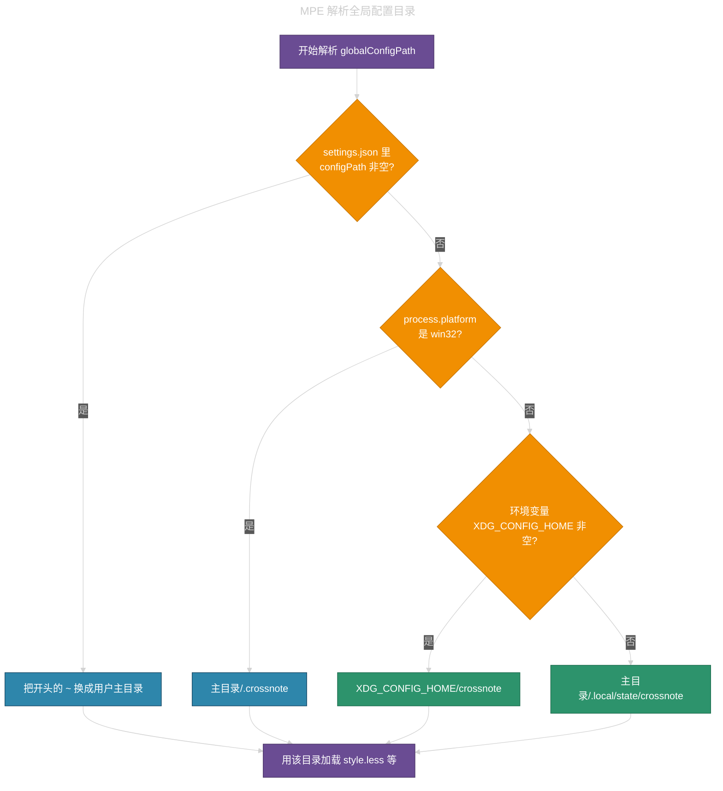
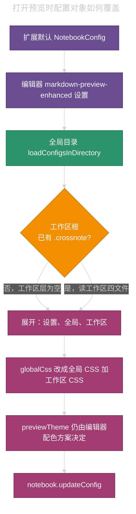

# Markdown Preview Enhanced：`.crossnote` 加载优先级（Windows / Linux）


## 目录 • Markdown Preview Enhanced：`.crossnote` 加载优先级（Windows / Linux）

- [1. 先记住两层，再谈路径](#1-先记住两层再谈路径)
- [2. 全局目录怎么解析](#2-全局目录怎么解析)
  - [2.1 Windows](#21-windows)
  - [2.2 Linux / *nix（含 macOS 扩展宿主）](#22-linux--nix含-macos-扩展宿主)
  - [2.3 文档写法与源码差一个点](#23-文档写法与源码差一个点)
  - [2.4 `configPath` 覆盖](#24-configpath-覆盖)
- [3. 打开预览时怎么叠四层](#3-打开预览时怎么叠四层)
  - [3.1 四个文件各自怎么赢](#31-四个文件各自怎么赢)
  - [3.2 `config.js` 盖不住的键](#32-configjs-盖不住的键)
- [4. 工作区路径怎么定](#4-工作区路径怎么定)
- [5. 远程工作区与 WSL](#5-远程工作区与-wsl)
- [6. 本机该改哪、不要改哪](#6-本机该改哪不要改哪)
- [7. 排查顺序](#7-排查顺序)

---

「Markdown Preview Enhanced」（下称 MPE）读配置时，先定全局目录，再和工作区目录、编辑器设置叠在一起。Windows 与 Linux 的全局目录不是同一条规则。Linux 上的 `~/.crossnote/` 默认不是全局配置。本机改样式应走「Customize CSS (Global)」打开的那份目录，不要在仓库里新建 `.crossnote`。

MPE 0.7.2 起，旧的 `~/.mume` 改名为 crossnote 配置目录。本文按当前扩展源码 `src/utils.ts` 的 `getGlobalConfigPath()`，以及 `src/notebooks-manager.ts` 的 `loadNotebookConfig()` 整理。

## 1. 先记住两层，再谈路径

加载分两层，不要混在一起。

| <span style="color:#C9A0FF">层</span> | <span style="color:#C9A0FF">是什么</span> | <span style="color:#C9A0FF">谁决定路径</span> | <span style="color:#C9A0FF">优先级</span> |
|------|------|------|------|
| 全局 `.crossnote` | 跟用户、跟机器走，跟仓库无关 | `markdown-preview-enhanced.configPath`，否则按 OS 默认 | 低于工作区 |
| 工作区 `.crossnote` | 工作区根下的 `<workspace>/.crossnote/` | 当前 Markdown 所属工作区根 | 高于全局（多数键覆盖；CSS 是拼接） |

官方发行说明写过：全局配置的优先级低于工作区配置。命令面板对应：

- 全局：`Markdown Preview Enhanced: Customize CSS (Global)`、`Customize Preview Html Head (Global)`
- 工作区：`Customize CSS (Workspace)` 等。会在仓库根创建 `.crossnote`，之后这份会盖过全局

本机约定：只改全局；工作区若已经有 `.crossnote`，不要擅自改、不要擅自删，只告诉使用者它会盖过全局。

`C:\Users\sn03910\.cursor\adil.docs\crossnote\` 是这份知识库里的配置副本，MPE 不会读这里。

## 2. 全局目录怎么解析

扩展启动时算一次 `globalConfigPath`。改 `markdown-preview-enhanced.configPath` 后必须重启编辑器。浏览器里的 VS Code Web 扩展不加载全局目录。



紫：起止。橙：分支。蓝：Windows 或手动覆盖。绿：Linux / *nix 默认。

### 2.1 Windows

未改 `configPath` 时，全局目录是：

`path.join(os.homedir(), './.crossnote')`

通常就是 `%USERPROFILE%\.crossnote\`。本机是 `C:\Users\sn03910\.crossnote\`。

| <span style="color:#C9A0FF">项</span> | <span style="color:#C9A0FF">值</span> |
|------|------|
| 默认全局目录 | `%USERPROFILE%\.crossnote\` |
| 是否看 `XDG_CONFIG_HOME` | 否。`win32` 分支直接回家目录 |
| `C:\Users\sn03910\.crossnote\` | 本机真正生效的全局目录 |
| `~\.mume` | 0.7.2 之前的旧目录，现行 MPE 不把它当默认 |

### 2.2 Linux / *nix（含 macOS 扩展宿主）

未改 `configPath` 时：

1. `XDG_CONFIG_HOME` 是非空字符串：`path.resolve(XDG_CONFIG_HOME, './crossnote')`，即 `$XDG_CONFIG_HOME/crossnote`
2. 否则：`path.resolve(os.homedir(), './.local/state/crossnote')`，即 `~/.local/state/crossnote`

Linux 上的 `~/.crossnote/` **不是**这条默认路径。把 `style.less` 写进家目录下的 `~/.crossnote/`，预览可以完全不变。

| <span style="color:#C9A0FF">条件</span> | <span style="color:#C9A0FF">全局目录</span> | <span style="color:#C9A0FF">本机例子</span> |
|------|------|------|
| 已设 `XDG_CONFIG_HOME` | `$XDG_CONFIG_HOME/crossnote` | 若值为 `/home/adil/.config`，则是 `/home/adil/.config/crossnote` |
| 未设该变量 | `~/.local/state/crossnote` | `/home/adil/.local/state/crossnote/` |
| 家目录 `~/.crossnote/` | 默认不读 | 不要当全局配置改 |

判断本机实际路径：命令面板跑 **Customize CSS (Global)**，看打开的 `style.less` 落在哪。不要凭记忆写 Linux 路径。

### 2.3 文档写法与源码差一个点

发行说明、`package.json` 里 `configPath` 的说明写成 `$XDG_CONFIG_HOME/.crossnote`（带点）。当前 `getGlobalConfigPath()` 拼接的是 `'./crossnote'`（不带点）。

| <span style="color:#C9A0FF">来源</span> | <span style="color:#C9A0FF">写法</span> |
|------|------|
| 0.7.2 发行说明、扩展设置描述 | `$XDG_CONFIG_HOME/.crossnote` |
| 当前 `src/utils.ts` | `$XDG_CONFIG_HOME/crossnote` |

以本机「Customize CSS (Global)」打开的文件为准。不要同时维护两套目录。

### 2.4 `configPath` 覆盖

设置键：`markdown-preview-enhanced.configPath`。

- 非空字符串：整段当作全局目录，不再走 Windows / XDG 分支
- 开头的 `~` 会换成 `os.homedir()`
- 改完必须重启
- 不要把这个键指到某个仓库的 `.crossnote`，否则「全局」会变成那份工作区配置

## 3. 打开预览时怎么叠四层

`NotebooksManager.loadNotebookConfig()` 的返回值是：

```ts
return {
  ...vscodeMPEConfig,
  ...globalConfig,
  ...workspaceConfig,
  globalCss:
    (globalConfig.globalCss ?? '') + (workspaceConfig.globalCss ?? ''),
  previewTheme,
};
```

从低到高：

1. 扩展默认值，已含在 `vscodeMPEConfig` 里
2. VS Code / Cursor 的 `markdown-preview-enhanced.*` 设置
3. 全局目录里的 `config.js`、`style.less`、`head.html`、`parser.js`
4. 工作区 `.crossnote` 里的同名文件（目录不存在则这一层是空对象）

`style.less` 编译后的 CSS 例外：全局与工作区**拼接**，不是后者丢掉前者。`head.html`、`parser.js`、`config.js` 的键是后面的对象覆盖前面。



紫：设置层。绿：全局目录。橙：是否存在工作区目录。品红：最终覆盖与拼接。

工作区目录只要存在，加载器就会去读；缺哪个文件会按模板**新建**一份空配置。因此误跑一次 **Customize CSS (Workspace)**，仓库里就会多出 `.crossnote`，之后 `head.html` / `parser.js` / `config.js` 会盖掉全局，只留下一份默认 stub。

### 3.1 四个文件各自怎么赢

| <span style="color:#C9A0FF">文件</span> | <span style="color:#C9A0FF">进配置的键</span> | <span style="color:#C9A0FF">工作区已存在时</span> |
|------|------|------|
| `style.less` | `globalCss` | 全局编译结果在前，工作区编译结果接在后面。两边样式都在。工作区写了更具体的选择器时，后写的规则更容易生效 |
| `head.html` | `includeInHeader` | 工作区整份替换全局。工作区是默认注释 stub 时，全局注入的脚本会消失 |
| `parser.js` | `parserConfig` | 工作区整份替换 |
| `config.js` | KaTeX / MathJax / Mermaid 等键 | 工作区对象覆盖同名键。安全相关键会被丢掉，见下节 |

`head.html` 里若用 `<script src="toc-level1-open.js">` 这类相对路径，文件必须和这份 `head.html` 在**同一目录**。全局 `head.html` 引用的 `.js` 要放在全局目录，不要只放在 `adil.docs/crossnote/`。

### 3.2 `config.js` 盖不住的键

工作区（以及沙箱里的）`config.js` 不能设置这些键；加载器会删掉并打警告。它们只认受信任的编辑器设置：

- `enableScriptExecution`
- `chromePath`
- `pandocPath`
- `imageMagickPath`
- `markdownYoBinaryPath`

`previewTheme` 也不走 `.crossnote` 覆盖链：由 `previewColorScheme`（所选预览主题 / 系统 / 编辑器）再算一次。

## 4. 工作区路径怎么定

工作区目录固定是：

`Uri.joinPath(getWorkspaceFolderUri(当前 Markdown 的 uri), './.crossnote')`

`getWorkspaceFolderUri` 的规则：

1. `vscode.workspace.getWorkspaceFolder(uri)` 能命中，用该文件夹
2. 否则在 `workspaceFolders` 里找 `uri.fsPath` 的前缀
3. 扩展宿主不是 Windows，且 `uri.fsPath` 带盘符（Remote SSH 把 Windows URI 送到 Linux 宿主）：退回第一个工作区文件夹
4. 再没有工作区：用该文件所在目录。单文件打开时，`.crossnote` 会落在 Markdown 旁边，而不是某个仓库根

多根工作区里，每个根可以有自己的 `.crossnote`。预览跟当前文件所属的那个根走。

## 5. 远程工作区与 WSL

全局目录永远在**扩展宿主所在机器**上，不在 Remote 那一侧的 Linux 家目录（除非扩展宿主就在那一侧）。

0.8.23 起，notebook 的 `fs` 带上了工作区 `authority`。用这份 `fs` 去读本机 `C:\Users\...\.crossnote` 时，URI 会错成 `file://wsl.localhost/C:/Users/...`，全局配置被静默丢掉。0.8.26（#2297）改为：全局加载单独用本机 `file` scheme、空 authority。

| <span style="color:#C9A0FF">场景</span> | <span style="color:#C9A0FF">全局 `.crossnote` 在哪</span> | <span style="color:#C9A0FF">工作区 `.crossnote` 在哪</span> |
|------|------|------|
| Windows 本地仓库 | Windows 用户目录 `\.crossnote\` | 仓库根 |
| Linux 本地仓库 | `~/.local/state/crossnote` 或 `$XDG_CONFIG_HOME/crossnote` | 仓库根 |
| Windows 开 WSL / SSH 远程文件夹 | 仍是 Windows 宿主上的 `%USERPROFILE%\.crossnote\`（扩展跑在 Windows 时） | 远程工作区根 |
| Cursor / VS Code 装在 WSL 里 | 那套 Linux 默认路径 | WSL 工作区根 |

远程预览看不到全局样式时，先看扩展版本是否早于 0.8.26，再确认改的是宿主机器上的全局目录。

## 6. 本机该改哪、不要改哪

| <span style="color:#C9A0FF">位置</span> | <span style="color:#C9A0FF">本机角色</span> | <span style="color:#C9A0FF">要不要改</span> |
|------|------|------|
| `C:\Users\sn03910\.crossnote\` | Windows 全局 | 要。Customize CSS / Html Head (Global) 打开的就是它 |
| `/home/adil/.local/state/crossnote/` | 未设 `XDG_CONFIG_HOME` 时的 Linux 全局 | 在 Linux 上改这一份 |
| Linux `~/.crossnote/` | 不是默认全局 | 不要当生效配置改 |
| `<仓库>/.crossnote/` | 工作区覆盖层 | 不要新建、不要改；发现已有则告知会盖过全局 |
| `adil.docs/crossnote/` | 知识库副本 | 不是运行时加载路径 |

保存后生效：

1. 在编辑器里保存刚改的**全局** `style.less` 或 `head.html`。只保存 `.md` 不会重编译外壳 CSS
2. 仍旧：关掉 MPE 预览再 Open Preview，或 `Developer: Reload Window`

侧栏目录宽度用 `--sidebar-toc-width`。不要给 `.md-sidebar-toc` 写 `width: … !important`，否则拖条失效。上次宽度记在 `localStorage` 的 `crossnote.sidebarTocWidth`。

## 7. 排查顺序

预览样式不对时，按这次序查，不要先猜 Linux 家目录。

1. 命令面板打开 **Customize CSS (Global)**，确认路径是不是上表里的全局目录
2. 看工作区根有没有 `.crossnote`。有则工作区 `head.html` / `parser.js` / `config.js` 已经在盖全局；`style.less` 是接在全局后面
3. 看 `markdown-preview-enhanced.configPath` 是否指到别处
4. Linux：看 `echo $XDG_CONFIG_HOME`。有值就去 `$XDG_CONFIG_HOME/crossnote`，不要去 `~/.crossnote`
5. 远程 / WSL：确认改的是扩展宿主那一侧；扩展是否已到 0.8.26
6. Web 预览：根本不加载全局目录
