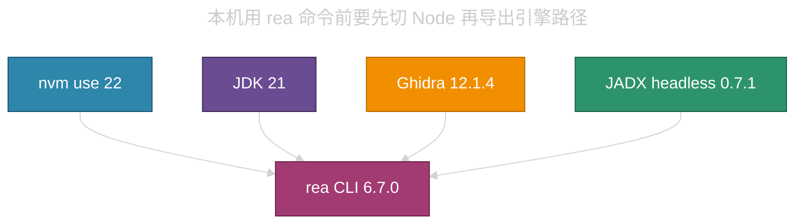

# REA 本机安装（Linux）


## 目录 • REA 本机安装（Linux）

- [1. 一次调用要齐哪些件](#1-一次调用要齐哪些件)
- [2. 路径与版本](#2-路径与版本)
- [3. 新开终端怎么用](#3-新开终端怎么用)
- [4. 当初怎么装上的](#4-当初怎么装上的)
  - [4.1 CLI](#41-cli)
  - [4.2 JDK 21](#42-jdk-21)
  - [4.3 JADX](#43-jadx)
  - [4.4 Ghidra 12.1.4](#44-ghidra-1214)
- [5. 更新与 MCP](#5-更新与-mcp)

---

本机在 2026-10-23 为反编译 APK 与 `libhal.so` 安装了「REA」（包名 `rea-agents` 6.7.0）。CLI 挂在 nvm 的 Node 22 全局目录，不在某个工程仓库里。Hopper、IDA、Kuna 未装。Cursor 的 MCP 也未跑 `rea setup`，当前会话只能走终端里的 `rea` 命令。

官方入口是 [morluto/rea](https://github.com/morluto/rea) 与 npm 包 `rea-agents`。REA 要求 Node.js 22.x（本机用 22.23.4）、24.x 或 26.12.1+。Android 分析要 JADX 与 JDK 17+；native 伪代码要 Ghidra 12.1.x（本机用 12.1.4）或 Hopper / IDA。

## 1. 一次调用要齐哪些件

nvm 默认仍是 Node 20。不切到 22 时，`PATH` 上没有 `rea`。Ghidra、JADX、JDK 的路径也没有写入 `~/.bashrc`，新开终端必须自己 `export`。



<span style="color:#2E86AB">蓝</span>是 Node 切换；<span style="color:#A23B72">玫</span>是 CLI；<span style="color:#6A4C93">紫</span>是 JDK；<span style="color:#F18F01">橙</span>是 Ghidra；<span style="color:#2D936C">绿</span>是 JADX。

## 2. 路径与版本

| <span style="color:#C9A0FF">件</span> | <span style="color:#C9A0FF">本机路径</span> | <span style="color:#C9A0FF">说明</span> |
|------|------|------|
| `rea` 可执行文件 | `/home/adil/.nvm/versions/node/v22.23.4/bin/rea` | 符号链接到 `rea-agents` 的 `scripts/rea.mjs` |
| npm 全局包 | `/home/adil/.nvm/versions/node/v22.23.4/lib/node_modules/rea-agents` | `rea-agents@6.7.0` |
| Node | nvm `v22.23.4` | 系统默认别名仍是 `v20.20.2` |
| JDK | `/home/adil/.local/jdk-21/jdk-21.0.13+9` | Temurin 21，`java -version` 为 `21.0.13` |
| Ghidra | `/home/adil/.local/ghidra_12.1.4_PUBLIC` | 含 `support/analyzeHeadless` 与 linux_x86_64 decompile |
| JADX JAR | `/home/adil/.local/share/rea/android/jadx-headless-mcp-0.7.1-all.jar` | REA 钉死的 headless MCP JAR |

环境变量（会话级，未写入登录脚本）：

| <span style="color:#C9A0FF">变量</span> | <span style="color:#C9A0FF">值</span> |
|------|------|
| `JAVA_HOME` | `/home/adil/.local/jdk-21/jdk-21.0.13+9` |
| `GHIDRA_INSTALL_DIR` | `/home/adil/.local/ghidra_12.1.4_PUBLIC` |
| `REA_JADX_MCP_JAR` | `/home/adil/.local/share/rea/android/jadx-headless-mcp-0.7.1-all.jar` |
| `REA_GHIDRA_STARTUP_TIMEOUT_MS` | 首次导入可设 `1800000`（毫秒）。小 so 通常不需要这么长 |

`rea doctor --provider ghidra` 在上述变量齐备时应报 Ghidra `available: true`、版本 `12.1.4`。Hopper、IDA、Kuna、Cursor MCP 注册会显示缺失，这是当前本机状态，不是安装失败。

## 3. 新开终端怎么用

```bash
export NVM_DIR="$HOME/.nvm"
. "$NVM_DIR/nvm.sh"
nvm use 22

export JAVA_HOME="$HOME/.local/jdk-21/jdk-21.0.13+9"
export PATH="$JAVA_HOME/bin:$PATH"
export GHIDRA_INSTALL_DIR="$HOME/.local/ghidra_12.1.4_PUBLIC"
export REA_JADX_MCP_JAR="$HOME/.local/share/rea/android/jadx-headless-mcp-0.7.1-all.jar"

rea doctor --provider ghidra
rea inspect-android-package /absolute/path/app.apk
rea decompile /absolute/path/lib.so rhal_open --provider ghidra --format json
```

复用已有 Ghidra 快照时加 `--snapshot /absolute/path/to/ghidra.snapshot`。`libhal.so` 的快照在 `/home/adil/y.apps/a.rea/b.libhal.so/decompiled/ghidra.snapshot`。

不要把 nvm 默认从 20 改成 22，除非使用者明确要求。其它工程仍可能依赖 Node 20。

## 4. 当初怎么装上的

### 4.1 CLI

```bash
nvm install 22
nvm use 22
npm install --global rea-agents
```

不要用当时的系统 Node 20 装这个包。REA 会拒绝过旧的运行时。

### 4.2 JDK 21

从 Adoptium 拉 Linux x64 Temurin 21，解压到 `~/.local/jdk-21/`。解压后实际根目录是 `jdk-21.0.13+9`，`JAVA_HOME` 必须指到这一层，不能只指到外层 `jdk-21`。

### 4.3 JADX

按 REA `docs/android-analysis.md` 下载钉死的 `jadx-headless-mcp-0.7.1-all.jar`，放到 `~/.local/share/rea/android/`，并用 SHA-256 校验：

`6e5eacf500b64292bfb73c49797c1958f6ee44646e43e868039ae7feb573ff75`

发布地址：

`https://github.com/1013503897/jadx-headless-mcp/releases/download/v0.7.1/jadx-headless-mcp-0.7.1-all.jar`

### 4.4 Ghidra 12.1.4

REA 只要 12.1.x，不要装当时的 12.2。本机文件名是 `ghidra_12.1.4_PUBLIC_20260921.zip`，官方 SHA-256：

`ddac49f903da9d5bac833e5cc79395098b9c33cfd3279be5f31bd00387d2d4db`

本机直连 `github.com:443` 会拒绝或超时。`ghfast.top` 对该 zip 返回 403。可用：

```bash
curl -fL -o /tmp/ghidra_12.1.4_PUBLIC_20260921.zip \
  "https://gh-proxy.com/https://github.com/NationalSecurityAgency/ghidra/releases/download/Ghidra_12.1.4_build/ghidra_12.1.4_PUBLIC_20260921.zip"
echo 'ddac49f903da9d5bac833e5cc79395098b9c33cfd3279be5f31bd00387d2d4db  /tmp/ghidra_12.1.4_PUBLIC_20260921.zip' | sha256sum -c -
unzip -q -o /tmp/ghidra_12.1.4_PUBLIC_20260921.zip -d "$HOME/.local"
```

解压后目录必须是 `$HOME/.local/ghidra_12.1.4_PUBLIC`。

## 5. 更新与 MCP

全局 CLI 更新：

```bash
nvm use 22
rea update
```

要把 REA 接到 Cursor，需要在同一套环境变量下跑 `npx rea-agents@latest setup`，再重启 Cursor。本机尚未做这一步。`~/.cursor/mcp.json` 里没有 REA 服务器。

卸载 CLI 只删 npm 包，不会自动删 Ghidra、JADX、JDK：

```bash
nvm use 22
npm uninstall --global rea-agents
```
